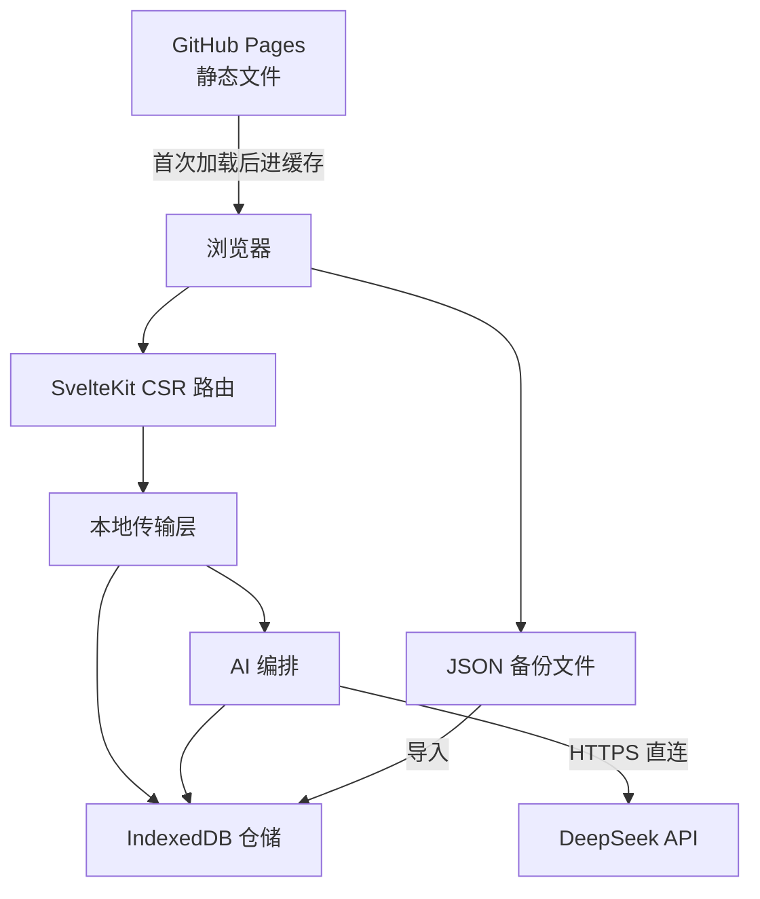

# 步序本地化改造实现方案

版本 1.0 · 2026-11-18

依据 [产品需求文档](../PRD.md)、[正式开发实现文档](./步序正式开发实现文档.md) 与当前 `main` 分支代码（提交 `abe8fa0`）。本文定义把现有全栈应用改造为纯静态本地自用版本的范围、实现契约与验收门槛，供开发直接执行。

## 1. 目标与范围

保留现有全部业务规则、界面与交互，把运行形态从「Node 服务 + SQLite」改为「静态文件 + 浏览器 IndexedDB」，使其可以托管在 GitHub Pages，不需要任何服务器进程。

| 维度 | 现状 | 改造后 |
| --- | --- | --- |
| 运行形态 | Node 进程，adapter-node，SSR | 纯静态文件，adapter-static，CSR |
| 数据位置 | 服务端 SQLite（`data/buxu.sqlite`） | 浏览器 IndexedDB |
| 数据共享 | 同一账号跨设备共享 | 单浏览器单份，不跨设备 |
| 账号体系 | 注册、登录、会话 Cookie | 无账号，无鉴权 |
| AI 调用 | 服务端转发，Key 以 AES-256-GCM 落盘 | 浏览器直连供应商，Key 存本地 |
| 部署 | Docker + Caddy + HTTPS 反代 | GitHub Pages |
| 源站地址 | 自定 | `https://yangxl12.github.io/personalDesk/` |

### 1.1 改与不改

| 类别 | 内容 |
| --- | --- |
| 不改 | PRD 全部业务规则、`app.css` 视觉体系、全部 DOM 结构与交互、文案与 i18n、目标/思考/财务/AI 四个功能域的行为 |
| 不改 | `src/lib/components/**`（2 处例外，见 3.2）、`src/lib/contracts/**` 的校验规则、`src/lib/editors.ts`、`src/lib/ui.svelte.ts`、`src/lib/translations.ts` |
| 删除 | 鉴权、HTTP 接口层、SQLite 与迁移、AI 配置加密、幂等键、模块修订号持久化、Docker 与反向代理配置 |
| 新增 | IndexedDB 仓储层、本地传输层兼容层、浏览器端 AI 编排、JSON 备份、Pages 部署流水线 |

**不做的**：数据从现有 SQLite 迁移。确认从头录入，`data/` 目录与 `migrations/` 一并移除。

## 2. 架构



### 2.1 核心策略：只换传输层

现有全部界面组件通过 `src/lib/client.ts` 的两个函数访问数据，签名固定：

```ts
request<T>(path: string, options?: RequestInit): Promise<{ data: T; revisions?: Revisions }>
commit<T>(method: string, path: string, body: object, key: string): Promise<{ data: T; revisions?: Revisions }>
```

改造保留这两个签名，把内部实现从 `fetch('/api/v1' + path)` 换成对本地仓储的调用，并按原路由字符串分派。返回值继续带 `revisions`，使 `refreshModules()` → `invalidate('buxu:' + module)` 的失效链条完全不变。

这是整个改造最大的成本节约点：**9 个文件、18 个调用点，一行都不用改**。

### 2.2 失效机制

`depends()` / `invalidate()` 在纯 CSR 下依然有效。改造后 `+page.ts` 的 `load` 从 IndexedDB 读数据，本地写入完成后递增 `meta` 表的模块计数并触发 `invalidate`，页面走与现在完全相同的重载路径。无需引入额外的响应式状态库。

## 3. 构建与静态托管

### 3.1 适配器与路径

`vite.config.ts` 内 `sveltekit()` 的配置整体替换：

```ts
import adapter from '@sveltejs/adapter-static'
import { sveltekit } from '@sveltejs/kit/vite'
import { defineConfig } from 'vite'

export default defineConfig({
  server: { port: 6173, strictPort: true },
  plugins: [sveltekit({
    adapter: adapter({ pages: 'build', assets: 'build', fallback: '404.html', precompress: false }),
    paths: { base: '/personalDesk' },
    csp: {
      directives: {
        'default-src': ['self'],
        'script-src': ['self'],
        'style-src': ['self', 'unsafe-inline'],
        'img-src': ['self', 'data:'],
        'connect-src': ['self', 'https:'],
        'object-src': ['none'],
        'base-uri': ['none'],
        'frame-ancestors': ['none'],
        'form-action': ['self']
      }
    }
  })]
})
```

- `paths.base` 必须为 `/personalDesk`，由仓库名决定。仓库改名则此处同步改，否则资源全部 404、页面白屏。
- `fallback: '404.html'`：GitHub Pages 无 SPA 重写能力，深链一律返回 404 页面，该文件即应用入口。首屏状态码为 404 属预期，功能不受影响。
- `connect-src` 必须放开到 `https:`。保留 `default-src 'self'` 会拦截发往 `api.deepseek.com` 的请求，且表现为难排查的网络错误。设置页支持自定义供应商地址，无法枚举域名，因此整体放开。CSP 以 `<meta>` 形式注入，`frame-ancestors` 在此形式下不生效，属已知限制。
- `.nojekyll` 在 Actions artifact 部署路径下**不需要**（不走 Jekyll 处理）。仅当改回 `gh-pages` 分支发布时才必须，否则 `_app/` 目录被忽略。

### 3.2 路径改写清单

`base` 生效后，根相对路径不会自动加前缀，需逐处处理。全量清单只有下面 5 处：

| 文件 | 现状 | 改法 |
| --- | --- | --- |
| `(app)/+layout.svelte:146` | `href="/settings"` | `resolve('/settings')` |
| `(app)/+page.svelte:31` | `goto('/', ...)` | `goto(resolve('/'), ...)` |
| `+error.svelte:11` | `href="/"` | `resolve('/')` |
| `(app)/+layout.svelte:120` | `goto('/login')` | 整段 401 处理删除 |
| `login/`、`register/` 目录 | 登录页 | 整目录删除 |

`resolve()` 来自 `$app/paths`，Kit 3.2.0 已提供，无需额外依赖。

### 3.3 组件层仅有的 2 处改动

| 文件 | 现状 | 改法 |
| --- | --- | --- |
| `ChatPanel.svelte:131` | `new EventSource('/api/v1/ai/runs/' + run + '/events')` | 改为 `subscribeRun(run, handler)`，返回 `{ close() }`，事件名与载荷结构保持不变 |
| `DataSettings.svelte:67` | `<a href="/api/v1/data/export" download>` | 改为按钮，点击生成 Blob 并触发下载 |

第二处因不再有接口端点而必须改；第一处因 `EventSource` 无法指向本地函数而必须改。除这两处，组件层无改动。

### 3.4 渲染模式

`src/routes/+layout.ts` 新增：

```ts
export const ssr = false
export const prerender = false
```

根布局改为等待本地初始化，`+layout.ts` 在 `load` 中先 `await openDb()` 再读取偏好与模型状态，返回形状与现有 `+layout.server.ts` 一致（`{ user, preferences, revisions, model }`），`user` 固定为 `{ id: 'local', username: 'local' }` 以兼容现有类型。首屏因此多一次 IndexedDB 打开耗时（冷启动约 10–40ms），不引入骨架屏。

## 4. 数据层

### 4.1 Dexie schema

新增依赖 `dexie@4`。库名 `buxu`，版本 1：

```ts
db.version(1).stores({
  goals:        'id, updated_at, title',
  items:        'id, goal_id, [goal_id+created_at]',
  tasks:        'id, item_id, [item_id+created_at]',
  notes:        'id, updated_at, created_at',
  transactions: 'id, occurred_on, [occurred_on+id]',
  savings:      'id',
  preferences:  'id',
  models:       'ref, provider',
  chats:        'id, updated_at',
  messages:     'id, conversation_id, &[conversation_id+seq], created_at',
  proposals:    'id, run_id, status',
  meta:         'key'
})
```

字段名、类型、取值范围沿用现有表结构与 `src/lib/contracts/workspace.ts` 的 Zod 契约，`savings` / `preferences` 固定单条记录，主键为 `'default'`。

### 4.2 存储约定

| 项 | 约定 |
| --- | --- |
| `user_id` | 全部移除。单用户，不再需要分区键 |
| `version` | 保留字段并在写入时递增，但**不做冲突校验**。本地单进程无并发写场景，保留只为维持 UI 传参契约 |
| 时间 | 继续用 UTC 毫秒整数；业务日期继续用 `YYYY-MM-DD` 字符串 |
| 排序 | `updated_at DESC, id DESC` 类排序用 `orderBy(...).reverse()` 后按 `id` 二次排序。单账号数据量在千条量级，内存排序开销可忽略 |
| 校验 | 继续使用 `inputs` 里的 Zod schema，在写入前执行。SQL 的 `CHECK` 约束因此自然等价 |
| 幂等键 | 删除。`commit()` 忽略 `key` 参数 |
| 模块修订号 | `meta` 表存 `{ key: 'rev:goals', value: number }`，语义与 `module_revisions` 一致 |

### 4.3 SQL 能力对照

| 现有 SQLite 能力 | 替代实现 | 注意 |
| --- | --- | --- |
| `WHERE user_id = ?` | 不适用 | 全部删除 |
| `ON DELETE CASCADE` | **手写级联** | Dexie 无外键。删目标时须在事务内依次删 `items` → `tasks`；删 `items` 同理删 `tasks`；删会话删 `messages` + `proposals`。遗漏将留下孤儿数据 |
| 事务 | `db.transaction('rw', a, b, c, fn)` | 计数维护与实体写入必须在同一事务内 |
| `goals.total_tasks / done_tasks` | 保留冗余计数，写入时重算 | 界面进度直接读这两个字段，不能改成实时 count |
| `WHERE occurred_on BETWEEN ? AND ?` | `where('occurred_on').between(start, end, true, false)` | 区间为 `[本月首日, 次月首日)` |
| 聚合 `SUM(amount_cents)` | `collection.toArray()` 后内存 reduce | 单月最多数百条，无需预聚合表 |
| 表达式索引 `total_tasks > 0 AND done_tasks = total_tasks` | 内存 filter | 目标总数在百条量级 |
| `UNIQUE(user_id, request_key)` | 删除 | 无幂等需求 |
| `schema_migrations` | 删除 | 改用 Dexie 自带的版本升级机制 |

### 4.4 文件归属

| 现有文件 | 行数 | 归宿 |
| --- | --- | --- |
| `server/db/workspace-queries.mjs` | 287 | `src/lib/local/store/workspace.ts`，按业务能力重写，不逐行翻译 |
| `server/db/ai-queries.mjs` | 361 | `src/lib/local/store/chats.ts`，其中运行状态机部分全部丢弃 |
| `server/db/data-queries.mjs` | 99 | `src/lib/local/store/transfer.ts` |
| `server/db/index.ts` + `worker.mjs` + `storage.mjs` | 200 | 删除。Worker 线程唯一的目的是隔离同步 SQLite，浏览器无此需求 |
| `server/ai/config.ts` | 261 | 删除。AES 加密、密钥文件、旧格式迁移全部不再需要 |
| `server/auth/**`、`server/http.ts`、`hooks.server.ts` | 220 | 删除 |
| `server/ai/runs.ts` | 277 | 重写为 `src/lib/local/ai/run.ts`，见第 5 节 |
| `migrations/*.sql` | 约 150 | 删除 |

净计：删除约 2,300 行，新增约 820 行。

## 5. AI

### 5.1 直连可行性

已实测 `OPTIONS https://api.deepseek.com/chat/completions`，预检返回：

```
access-control-allow-origin: <回显请求 Origin>
access-control-allow-methods: POST
access-control-allow-headers: authorization,content-type
access-control-allow-credentials: true
```

**DeepSeek 允许浏览器跨域调用，不需要任何中转服务。** `openai-compatible` 类供应商需在设置页保存前实测，不同厂商策略不一，不可假定可用。测试失败时给出明确提示，而非静默失败。

### 5.2 密钥存放

| 项 | 决定 |
| --- | --- |
| 存放位置 | IndexedDB 的 `models` 表，与模型配置同行，明文字段 `apiKey` |
| 录入方式 | 设置页表单。首次使用必须填写 |
| 禁止事项 | **不得**使用 `VITE_*` 环境变量或用构建期注入。环境变量会被打进 JS 产物并随 Pages 一同公开 |
| 导出行为 | 备份 JSON **排除** `models` 表。还原后需重新填 Key |
| 风险说明 | 同源脚本可读。本地自用场景可接受，需在设置页以一行说明告知 |

### 5.3 运行时简化

现有 `runs.ts` 的 277 行中，大部分服务于「服务端独立进程 + 多端订阅」。单浏览器单进程下不成立，全部移除：

| 机制 | 现状用途 | 处置 |
| --- | --- | --- |
| SSE + 心跳 15s | 跨连接到服务端进程 | 删除。改为内存回调直接推送 |
| 序号与事件去重 | 保证多端订阅顺序 | 删除 |
| `ai_runs` 表与状态机 | 刷新/换设备后恢复进行中的运行 | 删除。刷新即中断，符合本地体验 |
| `recover()` / `interrupted` | 进程重启后清理残留运行 | 删除 |
| 每 2 秒 flush 部分文本 | 断线后可恢复已生成内容 | 删除。结束时一次落库 |
| `permissionsChanged()` 中断 | 撤销数据授权时终止运行 | 保留语义，改为设置页保存后中断当前运行 |

保留的关键能力：

- `streamText` + `stepCountIs(4)` + `maxOutputTokens: 1000`，参数不变
- 全部工具（`find_goals` / `get_goal` / `find_notes` / `get_note` / `get_finance_summary` / `suggest_navigation` / `propose_changes`），仅把 `database(...)` 换成 IndexedDB 查询
- 45 秒硬超时、6 次工具调用上限、31,000 字符输入预算、域名权限掩码
- proposal 审批流程：生成 → 存 `proposals` 表 → 用户确认 → 事务执行 → 回写结果

运行时对象只保留 `{ runId, chatId, snapshot, abort }` 放内存，`subscribeRun` 向挂载的回调推 `snapshot` / `text_delta` / `sources` / `proposal` / `done` / `error`，事件名与载荷结构对齐现有 `ChatPanel` 的消费逻辑。

`streamText` 在浏览器环境下的可用性依赖 `ai@7.0.171` 与 `@ai-sdk/deepseek@3.0.86` 的 web 条件导出。**此为改造前必须验证的第一项**，验证方式见 9.1。

## 6. 备份与恢复

IndexedDB 会被浏览器清理策略、隐私模式、手动清缓存抹掉，且不跨设备。备份不是可选项。

**导出格式**

```json
{
  "format": "buxu-backup",
  "version": 1,
  "exportedAt": 1763550000000,
  "counts": { "goals": 12, "tasks": 48, "notes": 30, "transactions": 210 },
  "data": {
    "goals": [], "items": [], "tasks": [], "notes": [],
    "transactions": [], "savings": {}, "preferences": {},
    "chats": [], "messages": []
  }
}
```

不含 `models`，不含 `proposals`。

**导入行为**

预览先显示条数与校验错误，确认后在一个 Dexie 事务内整体写入。导入模式分「合并」与「替换」，默认替换并要求二次确认。`version` 字段高于当前支持值时拒绝导入并提示。

**提醒策略**

`meta` 表记录 `lastBackupAt`。超过 7 天未导出时，工作台底部出现一次可关闭的提示条。不做自动下载——浏览器无法静默写文件，每次自动下载都会污染下载目录。

## 7. 部署

仓库 `yangxl12/personalDesk`，站点根路径 `/personalDesk`。

`.github/workflows/pages.yml`：

```yaml
name: Deploy to GitHub Pages

on:
  push:
    branches: [main]
  workflow_dispatch:

permissions:
  contents: read
  pages: write
  id-token: write

concurrency:
  group: pages
  cancel-in-progress: true

jobs:
  build:
    runs-on: ubuntu-latest
    steps:
      - uses: actions/checkout@v4
      - uses: actions/setup-node@v4
        with:
          node-version: '24'
          cache: npm
      - run: npm ci
      - run: npm run check
      - run: npm run build
      - uses: actions/upload-pages-artifact@v3
        with:
          path: build

  deploy:
    needs: build
    environment:
      name: github-pages
      url: ${{ steps.deployment.outputs.page_url }}
    runs-on: ubuntu-latest
    steps:
      - id: deployment
        uses: actions/deploy-pages@v4
```

首次部署前置操作：仓库 **Settings → Pages → Source** 选 **GitHub Actions**。选错为「Deploy from a branch」会读到空分支，表现为 404。

`package.json` 脚本调整：删除 `start`、`account`、`backup`、`migrate`；`build` 保持 `vite build`；新增 `preview:static` 为 `vite preview`。依赖移除 `@sveltejs/adapter-node`、`undici`，新增 `@sveltejs/adapter-static`、`dexie`。

## 8. 风险与限制

| 风险 | 影响 | 应对 |
| --- | --- | --- |
| 不跨设备同步 | 手机与电脑各自一份数据 | 已确认为接受项。跨端需求出现时以导出/导入过渡 |
| 清理浏览器数据即丢失 | 数据不可恢复 | 7 天备份提醒 + 导出格式版本化 |
| `github.io` 国内访问不稳 | 偶发打不开或加载缓慢 | 已确认为接受项。长期可换 Cloudflare Pages，产物与 `base` 配置需同步调整 |
| API Key 明文存储 | 同源脚本可读 | 本地自用可接受。设置页告知，不随备份导出 |
| 自定义供应商 CORS 未知 | 保存后请求被浏览器拦截 | 保存前实测，失败时给出可执行提示 |
| 免费账号 Pages 限制 | 私有仓库无法发布 Pages | 仓库须为 public，或账号升级至 Pro |
| `base` 配置错误 | 整站白屏、资源 404 | 构建产物路径检查纳入验收 |
| AI SDK 浏览器兼容性 | 若 web 导出缺失，AI 面板不可用 | 9.1 阶段先行验证，失败则退回手写 `fetch` + SSE 解析（约 120 行） |

## 9. 开发顺序

| 阶段 | 任务 | 完成条件 |
| --- | --- | --- |
| 1. 可行性验证 | 装 `adapter-static` + `dexie`，改构建配置，写一个临时页面验证 `streamText` 在浏览器直连 DeepSeek 能出流 | 静态产物本地 `vite preview` 可访问；AI 流式返回可见文本，或明确判定需退回手写 SSE |
| 2. 骨架迁移 | 切 `ssr = false`，删服务端目录与鉴权路由，5 处路径改用 `resolve()`，组件 2 处例外改完 | 页面能加载、路由能跳转、无 404 资源；暂时以空数据渲染 |
| 3. 数据层 | Dexie schema + `workspace.ts` + `transfer.ts`，传输层兼容层接通 | 工作台读取、目标增删改、任务勾选、思考 CRUD、财务记账与月度汇总全部正确，刷新后保持 |
| 4. AI 层 | `run.ts` + 工具改查 IndexedDB + `subscribeRun` 接管 ChatPanel + proposal 审批 | 六条典型提示词全部跑通，刷新中断符合预期，审批后工作台同步更新 |
| 5. 收尾 | 备份导出/导入、备份提醒、设置页 Key 表单改造、CSP 复核 | 导出文件可导入还原；Key 不出现在任何构建产物中（产物全文检索验证） |
| 6. 上线 | Pages 配置、首次部署、手机实机验证 | 手机可打开、可录数据、AI 可用；`base` 路径下所有资源 200 |

第 1 阶段是唯一的硬性前置。若 `streamText` 在浏览器不可用，改动面仅限 `run.ts` 内部，不影响其余阶段排期。

## 10. 验收清单

- [ ] `npm run build` 产物中全文检索不到任何 API Key 片段
- [ ] `vite preview` 与 GitHub Pages 两个环境下，所有静态资源返回 200，无 404
- [ ] 深链直接访问（如 `/settings`）可正常渲染，不出现空白页
- [ ] 目标：新建、改名、删任务、批量删任务、删整个目标，级联删除后无孤儿 `tasks`
- [ ] 目标进度在勾选/取消后立即正确，全部完成时显示「已完成」，零任务显示「暂无任务」
- [ ] 思考：正文必填校验、摘要生成、按更新时间倒序、编辑后卡片即时更新
- [ ] 财务：跨月切换、日期归属月正确、金额两位小数校验、结余可为负、存款进度与「已达成」
- [ ] AI：流式输出、工具调用、来源链接可点击并跳到对应位置、`/?month=` 落地打开弹窗、失败可重试、可中断
- [ ] AI：proposal 确认后数据变更一次且仅一次，拒绝后数据不变
- [ ] 刷新页面后 AI 进行中的回复按预期中断，历史消息完整
- [ ] 导出 JSON → 清空 IndexedDB → 导入，数据与导出前逐项一致
- [ ] 手机 Safari 与 Chrome：全屏 AI 面板、侧滑关闭、软键盘不遮挡输入框
- [ ] 断开网络后，已加载的页面可正常读写本地数据（AI 除外）

## 11. 技术依据

- [SvelteKit 3 配置](https://svelte.dev/docs/kit/migrating-to-sveltekit-3) · [adapter-static](https://svelte.dev/docs/kit/adapter-static) · [单页应用模式](https://svelte.dev/docs/kit/single-page-apps) · [`$app/paths`](https://svelte.dev/docs/kit/$app-paths)
- [GitHub Pages 发布源与 Actions 部署](https://docs.github.com/pages/getting-started-with-github-pages/configuring-a-publishing-source-for-your-github-pages-site)
- [Dexie 4 索引与事务](https://dexie.org/docs/)
- [Vercel AI SDK `streamText`](https://ai-sdk.dev/docs/reference/ai-sdk-core/stream-text) · [DeepSeek 工具调用](https://api-docs.deepseek.com/guides/tool_calls/)
